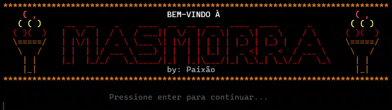

# MASMORRA

[English](README.md) | Português

[](#início-rápido)
[-brightgreen.svg)](#início-rápido)
[](#início-rápido)
[](#opções-de-cor)

Um clássico *Dungeon Crawler* de terminal baseado em turnos, encapsulado em um único arquivo C monolítico — sem dependências externas, compilação multiplataforma, detecção de cores ANSI em tempo de execução, 5 andares de masmorra, melhorias em lojas, emboscadas de mímicos e três finais.



## Início Rápido

### Baixar e Jogar (Recomendado)

Baixe o binário pré-compilado na [página de Releases](https://github.com/paixonite/MASMORRA/releases):

- **Windows:** Baixe `masmorra_windows.exe` e dê um duplo clique (ou execute pelo Prompt de Comando / PowerShell).
- **Linux:** Baixe `masmorra_linux`, dê permissão de execução e execute:

```bash
chmod +x masmorra_linux
./masmorra_linux
```

### Compilar a partir do Código-Fonte

A compilação é instantânea com qualquer compilador C padrão (`gcc`, `clang` ou MinGW):

#### Linux / macOS

```bash
git clone https://github.com/paixonite/MASMORRA.git
cd MASMORRA
gcc MASMORRA.c -o masmorra -Wall
./masmorra
```

#### Windows (MinGW)

```cmd
gcc MASMORRA.c -o masmorra.exe -Wall
masmorra.exe
```

## Opções de Cor

As cores do terminal são detectadas automaticamente em tempo de execução com fallback para monocromático, e podem ser substituídas via flags de linha de comando:

```bash
./masmorra --color      # Força a saída de cores ANSI
./masmorra --no-color   # Desativa as cores ANSI (modo monocromático)
```

## Autor

- **Vítor Paixão** - [https://github.com/paixonite](https://github.com/paixonite)
