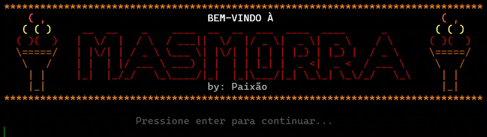

# MASMORRA

English | [Português](README-pt.md)

[](#quick-start)
[-brightgreen.svg)](#quick-start)
[](#quick-start)
[](#color-options)

A classic turn-based terminal *Dungeon Crawler* encapsulated in a single monolithic C file—zero external dependencies, cross-platform builds, runtime ANSI color detection, 5 dungeon floors, shop upgrades, mimic ambushes, and three endings.



## Quick Start

### Download & Play (Recommended)

Grab a pre-compiled binary from the [Releases page](https://github.com/paixonite/MASMORRA/releases):

- **Windows:** Download `masmorra_windows.exe` and double-click it (or run it from Command Prompt / PowerShell).
- **Linux:** Download `masmorra_linux`, make it executable, and run it:

```bash
chmod +x masmorra_linux
./masmorra_linux
```

### Compile from Source

Compilation is instant with any standard C compiler (`gcc`, `clang`, or MinGW):

#### Linux / macOS

```bash
git clone https://github.com/paixonite/MASMORRA.git
cd MASMORRA
gcc MASMORRA.c -o masmorra -Wall
./masmorra
```

#### Windows (MinGW)

```cmd
gcc MASMORRA.c -o masmorra.exe -Wall
masmorra.exe
```

## Color Options

Terminal colors are auto-detected at runtime with automatic monochrome fallback, and can be overridden with CLI flags:

```bash
./masmorra --color      # Force ANSI color output
./masmorra --no-color   # Disable ANSI colors (monochrome mode)
```

## Author

- **Vítor Paixão** - [https://github.com/paixonite](https://github.com/paixonite)
